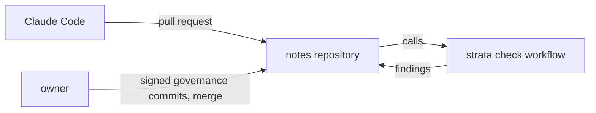

# strata

[](https://github.com/lucawalz/strata/actions/workflows/ci.yml)
[](https://github.com/lucawalz/strata/releases)
[](LICENSE)


A self-hosted knowledge base on git that AI agents maintain through pull requests.



## Description

strata turns a private git repository of Markdown notes into a knowledge base that agents keep organised and every Claude surface can search. Every change arrives as a pull request that has to pass checks, and governance files change only through commits signed by the owner.

This repository holds the note format, the `strata` command that checks a notes repository in CI, and the reusable workflows a notes repository calls.

## Installation

Not released yet. Build from source with Go 1.27 or later:

```
go install github.com/lucawalz/strata/cmd/strata@latest
```

## Usage

Check the notes tree of a repository (defaults to the current directory):

```
strata check tree --root DIR --format text
```

Check a pull request range for add-only changes under `raw/`, append-only edits, governance isolation and commit signatures:

```
strata check diff --base SHA --head SHA --root DIR
```

Audit a pushed range for governance changes without an owner signature:

```
strata audit --before SHA --after SHA --root DIR
```

Measure the characters-per-token ratio of sample notes and print proposed size caps; the key is read from `ANTHROPIC_API_KEY`:

```
strata calibrate --model MODEL DIR
```

The default caps come from one run on 2026-11-20 over 64 sample notes with `claude-opus-5-5`: 2.31 characters per token, giving 700, 3500 and 6900 characters.

Copy the embedded capture and curate skills into a skills directory; directories with other names are left alone:

```
strata skills sync --to .claude/skills
```

`--format github` prints GitHub workflow commands instead of text lines.

A notes repository calls the reusable workflows `check.yml`, `audit.yml` and `gate.yml` from its own workflows. The caller of `check.yml` grants `contents: read`. The caller of `audit.yml` grants `contents: read` and, on its report job, `issues: write`. The caller job of `gate.yml` uses `secrets: inherit` and passes the aggregate `result` of its check jobs and the `head-sha` to report on. `GATE_APP_ID` and `GATE_APP_PRIVATE_KEY` exist only as secrets of the `gate` environment, which is limited to `main`, and never as repository secrets.

## Support

Report vulnerabilities privately as described in [SECURITY.md](SECURITY.md). For other questions, open an issue.

## Roadmap

1. Foundation: note format, checks, governance, local search (in progress)
2. First agent identity and `@strata` commands
3. Connector for every Claude surface
4. Earned autonomy with canary-tested reviews
5. Paperless ingest
6. Hardened self-hosted runners and vault import
7. First public release with self-hosting documentation

## Contributing

Contributions are welcome. See [CONTRIBUTING.md](https://github.com/lucawalz/.github/blob/main/CONTRIBUTING.md) for the workflow and conventions and the [Code of Conduct](https://github.com/lucawalz/.github/blob/main/CODE_OF_CONDUCT.md) for participation, and the architecture decision records under [docs/adr/](docs/adr/) for the reasoning behind the major design choices. Run the local checks before opening a pull request:

```
just check
```

## Authors and acknowledgment

Maintained by Luca Walz.

## License

[MIT](LICENSE)

## Project status

In development.
